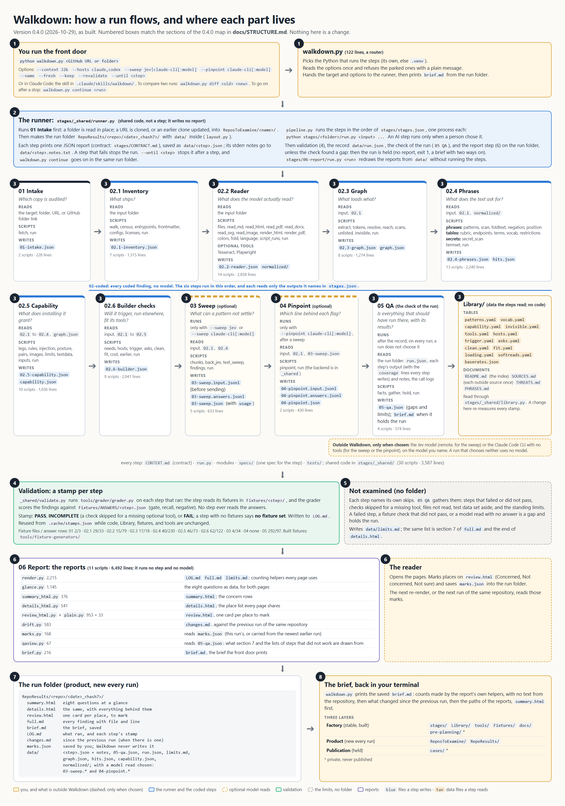
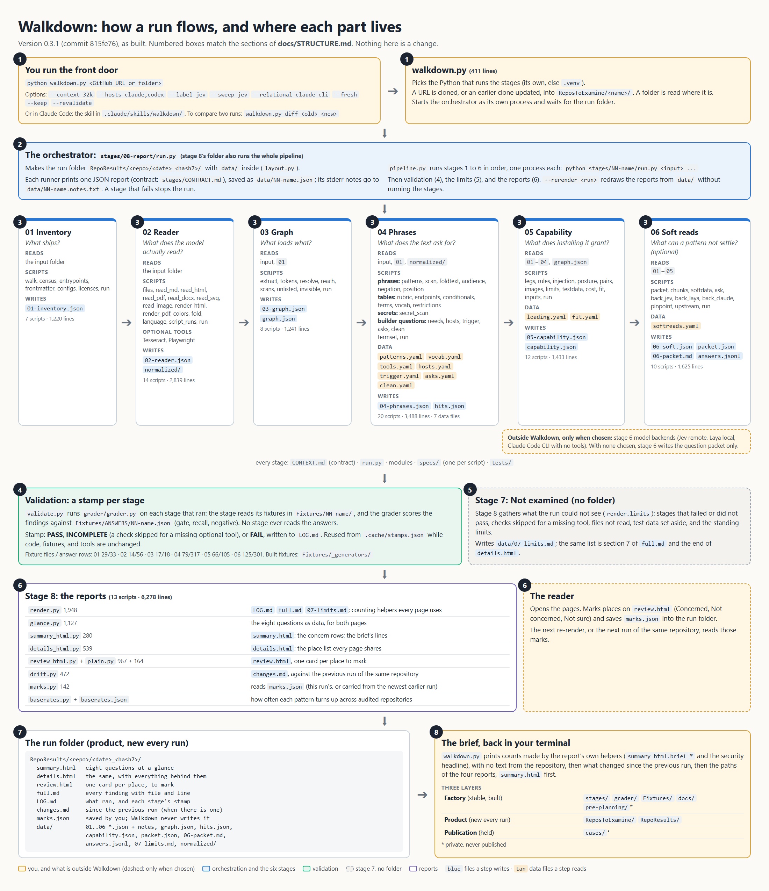

# How Walkdown is built: the structure maps

Two maps of what Walkdown does, in order, and where each thing lives, one for each version, so the
build can be walked step by step and checked. They have the same numbered shape, and the numbered
boxes of each picture match the numbered sections of its map. A map changes nothing.

- **Version 0.4.0** (2026-10-29), the restructured build, is first. Its picture is
  [structure-map-0.4.0.png](structure-map-0.4.0.png).
- **Version 0.3.1** (commit `815fe76`) follows it, as it was written, with the names of that
  version. Its picture is [structure-map.png](structure-map.png).

---

# Version 0.4.0 (2026-10-29)

0.4.0 is 0.3.1 reorganized, with a few things cut and the reports left as they were (the list of
what differs is in [CHANGELOG.md](../CHANGELOG.md)). The stages of 0.3.1 became numbered steps with
one folder each, the data every step reads moved to `Library/`, the factory's tools moved to
`tools/`, and the front door became a router.



## 1. The front door: `walkdown.py`

You run one command:

```
python walkdown.py <GitHub URL or folder> [--context 32k] [--hosts claude,codex] [--sweep jev|claude-cli[:model] [--pinpoint claude-cli[:model]] | --reads [model]] [--until STEP] ...
python walkdown.py continue <run folder> [--until STEP] [--sweep jev|claude-cli[:model] | --reads [model]] ...
```

`walkdown.py` (123 lines) only routes:

- Picks the Python that runs the steps: the one it was started with when that has Walkdown's
  packages, else the project's `.venv`.
- Reads the options once (`stages/_shared/options.py`), refusing the parked ones (labeling, the second
  labeler, the relational reads, the double read) with a plain message.
- Hands the target and the options to the runner (section 2) and prints the brief the run saved.
- `walkdown.py diff <old run> <new run>` compares two runs (`stages/06-report/drift.py`).
- `walkdown.py continue <run folder>` goes on in a run that stopped with `--until` (`runner.resume`), or writes the
  report of a run the check of the run held (`runner.release`).

The same command is wrapped for Claude Code by the skill in `.claude/skills/walkdown/`.

## 2. The runner: `stages/_shared/runner.py`

The runner is code several folders share, so it lives in `stages/_shared/`. It takes a target to a run
folder and writes no report.

- Runs `01-intake` first: a folder is read in place, a URL is cloned or an earlier clone updated
  (`--fresh` clones again; `--keep` keeps it as it is). A failure stops the run before any folder exists.
- Makes the run folder `RepoResults/<repo>/<date>_<hash7>/`, with `data/` inside (`layout.py`).
- `pipeline.py` runs the steps in the order of `stages/stages.json`, one process each:
  `python stages/<folder>/run.py <input> ...`. Each prints one JSON report on stdout, saved as
  `data/<step>.json`; its notes on stderr are saved as `data/<step>.notes.txt`. A step that fails
  stops the pipeline. An AI step runs only when a person chose it.
- Then validation (section 4), then the record (`data/run.json`, `record.py`), then the check of the run
  (`stages/05-qa/run.py <run folder>`, section 3.10), then the report step (`stages/06-report/run.py <run folder>`)
  as a subprocess. When the check finds a gap the run is held instead: `held` in the record, the brief the check
  wrote, no report, exit 1.
- `--until <step>` stops the run after a step; when a chosen AI step would come next, it writes what it
  would send (`--input-only`) and stops, and nothing is sent. `walkdown.py continue <run folder>` goes on
  in the same run folder (`runner.resume`); on a held run it runs no step and writes the report with what the run has.
- `python stages/06-report/run.py <run folder>` redraws the reports of an existing run from its
  `data/`, without running any step.

Every step follows one contract, `stages/CONTRACT.md`: one JSON report
(`{"stage", "contract": 1, "findings": [...]}`, and for the steps from `02.1` to `04-pinpoint` a `coverage` list of what
each check looked at), every finding with `check`, `file`, and `line`, a
skipped check reported as a finding with `skipped`, and nothing written inside the input.

## 3. The steps

Each step folder holds `CONTEXT.md` (a short contract: inputs, process, outputs, the human check),
`run.py` (its runner), its modules, `specs/` (one spec for the step) and `tests/`. The data a step
reads is in `Library/`. The six coded steps, `02.1` to `02.6`, sit in the folder
`02-coded/`, which has a `CONTEXT.md` of its own for the group; they run in that order, and none of
them uses a model.

### 3.1 `01-intake`: which copy is audited?

- **Reads:** the target (a folder, a URL, a GitHub folder link) and `--name`, `--fresh`, `--keep`.
- **Scripts (2, 228 lines):** `fetch.py` (the URL test, GitHub folder links, clone or update, the git
  errors), `run.py`.
- **Writes:** `data/01-intake.json`: one finding, `intake.source` (the target as given, what was done,
  the folder audited, the name the run is filed under).

### 3.2 `02.1-inventory`: What ships

- **Reads:** the input folder.
- **Scripts (9, 2,141 lines):** `walk.py` (list and pin the files), `census.py` (per-file facts and
  structural flags), `archive_index.py` (the members of a 7z or RAR archive, from its own headers), `entrypoints.py` (what kind of entry each file is), `frontmatter.py`
  (descriptions and tool grants), `configs.py` (hook configs, platform manifests, MCP servers),
  `spans.py` (the lines a parsed value came from), `licenses.py`, `run.py`.
- **Writes:** `data/02.1-inventory.json`. Checks: `inv.file`, `inv.pin`, `inv.license`,
  `struct.census`, `struct.description`, `struct.agent-tools`, `struct.hooks`, `struct.manifests`,
  `struct.mcp`.

### 3.3 `02.2-reader`: What the model actually reads

- **Reads:** the input folder.
- **Scripts (14, 2,886 lines):** `files.py` (list, classify, decode), one reader per format
  (`read_md.py`, `read_html.py`, `read_pdf.py`, `read_docx.py`, `read_svg.py`, `read_image.py`),
  drawn readings (`render_html.py` with Playwright, `render_pdf.py`), `colors.py`, `fold.py` (folded
  copy; reads `Library/invisible.yaml`), `language.py`, `script_runs.py`, `run.py`.
- **Optional tools:** Tesseract (OCR of images and PDF pages), Playwright with Chromium (HTML as a
  browser draws it).
- **Writes:** `data/02.2-reader.json` and `data/normalized/` (the text it read from each file,
  including PDF, DOCX, and image text). Checks: `read.divergence`, `read.fold`, `read.language`,
  `read.metadata`, `read.script`, `read.unread`.

### 3.4 `02.3-graph`: What loads what

- **Reads:** the input folder and `data/02.1-inventory.json`.
- **Scripts (8, 1,274 lines):** `extract.py` (every reference a file makes), `tokens.py`,
  `resolve.py`, `reach.py` (reachability and depth), `scans.py` (code that lists a folder),
  `unlisted.py` (manifest against disk), `invisible.py` (strips invisible characters; reads
  `Library/invisible.yaml`), `run.py`.
- **Writes:** `data/02.3-graph.json` and `data/graph.json` (the edges). Checks: `graph.entry`,
  `graph.depth`, `graph.orphan`, `graph.dynamic`, `graph.dangling`, `graph.unlisted`,
  `graph.unscanned`, `graph.case`.

### 3.5 `02.4-phrases`: What the text asks for

- **Reads:** the input folder, `data/02.1-inventory.json`, and the reader's `data/normalized/` text.
- **Scripts (14, 2,559 lines):**
  - the phrase layer: `patterns.py`, `scan.py`, `foldtext.py` (the fold), `negation.py`,
    `position.py`;
  - the tables: `rubric.py`, `endpoints.py`, `terms.py` + `vocab.py`, `restrictions.py`;
  - secrets: `secret_scan.py` (detect-secrets, and key shapes of its own);
  - MCP code: `tooltext.py` (the lines an MCP server sends the model: descriptions, a prompt's text, a tool's reply);
  - and `termset.py` (the version of the search terms and of the matching code, which includes the
    shared modules the step imports and the invisible-character list), `run.py`.
- **Data:** `Library/patterns.yaml` (the pattern table, each row with its plain words),
  `Library/vocab.yaml`, and `Library/invisible.yaml`.
- **Writes:** `data/02.4-phrases.json` and `data/hits.json`. Checks: `phrase.*` (one per pattern
  group), `rubric.action`, `endpoint.host`, `term.def`, `term.conflict`, `term.safety`,
  `limit.setting`, `secret.found`, `pos.density`, `rep.sentence`.

### 3.6 `02.5-capability`: What this touches

- **Reads:** `02.1` to `02.4` and `graph.json` from the run's `data/` (`inputs.py`).
- **Scripts (10, 1,032 lines):** `legs.py` + `rules.py` (the three trifecta legs and install grants; the
  rules are `Library/capability.yaml`), `injection.py` (text that reaches the AI at load),
  `posture.py`, `pairs.py` (a phrase hit on an orphan file, a folder-only load, or hidden text; reads
  `Library/invisible.yaml`), `images.py`, `limits.py` (stated limits and what backs them), `testdata.py` (test data set
  aside), `inputs.py`, `run.py`.
- **Writes:** `data/02.5-capability.json` (citations capped) and `data/capability.json` (every
  citation). Checks: `cap.leg`, `cap.grant`, `cap.injection`, `cap.load-bytes`, `cap.posture`,
  `cap.pair`, `cap.limit`, `cap.testdata`.

### 3.7 `02.6-builder`: Builder checks

- **Reads:** the input folder, and `02.1` to `02.5` from the run's `data/` (`earlier.py`).
- **Scripts (9, 2,052 lines):** `needs.py`, `hosts.py`, `trigger.py`, `asks.py`, `clean.py`, `fit.py`,
  `cost.py` (what ships and what it costs in tokens), `earlier.py`, `run.py`.
- **Data:** `Library/tools.yaml`, `hosts.yaml`, `trigger.yaml`, `asks.yaml`, `clean.yaml`, `fit.yaml`,
  `loading.yaml`.
- **Writes:** `data/02.6-builder.json`. Checks: `need.*`, `port.*`, `host.*`, `trig.*`, `ask.*`,
  `fit.*`, `clean.*`, `cap.ship`, `cap.context`.

### 3.8 `03-sweep`: Needs a human read (optional, experimental)

- **Runs only with:** `--sweep jev`, or `--sweep claude-cli` with the model after a colon if you name one
  (`claude-cli:<model>`; a bare `claude-cli` runs `sonnet`, and Walkdown picks no model for a run where nothing is named), or with
  `--reads [model]`, which the front door turns into one of those before the run starts. A run that does not choose it has no row and no files.
- **Reads:** the input folder, `data/02.1-inventory.json`, `data/02.4-phrases.json` (what a pattern already hit, and the lines the secret
  scan flagged, which are not sent).
- **Scripts (5, 625 lines):** `chunks.py` (the prose a model reads, cut into passages), `back_jev.py`
  (Jev, remote; answers with a probability for each kind), `text_sweep.py` (the read by a model that takes text: the data's
  question, the kinds, and the passage marked as data; the answer is one kind's name and no probability), `findings.py`,
  `run.py`. Data: `Library/softreads.yaml`. The calls (the first call alone, the one extra try, the stop on a rejected key, the
  workers) are `_shared/textmodel.py`'s.
- **Writes:** `data/03-sweep.input.jsonl` (exactly what the model is shown, on disk before anything is
  sent), `data/03-sweep.answers.jsonl` (every answer as it came back), `data/03-sweep.calls.jsonl` (the call
  log: one line for each passage whose first try got no answer or that was not sent; only when there is a line),
  `data/03-sweep.json` (`soft.sweep`, and a `usage` block: the tokens the calls reported and the calls sent). With
  `--input-only` (a run stopped with `--until` just before it) only the input file.

### 3.9 `04-pinpoint`: The line behind each flag (optional, experimental)

- **Runs only with:** `--pinpoint claude-cli` (with `:model` if you name one), or `--reads` when the `claude` command is found, and only after a sweep.
- **Reads:** the input folder, `data/02.1-inventory.json`, `data/02.4-phrases.json` (the lines the secret scan flagged, which are
  not sent), `data/03-sweep.json`.
- **Scripts (2, 447 lines):** `pinpoint.py` (targets, question, check, and the Reader: this step's side of a text model),
  `run.py`. The backend is `_shared/back_claude.py` (the Claude Code CLI with no tools, no settings, no project files; a call
  that gets no answer is tried once more); the sweep uses it too.
- **Writes:** `data/04-pinpoint.input.jsonl`, `data/04-pinpoint.answers.jsonl`, `data/04-pinpoint.calls.jsonl`
  (only when there is a line), `data/04-pinpoint.json` (`soft.pinpoint`, kept only when the quote is found in
  the passage), and a `usage` block in the report. With `--input-only` only the input file. It is not started after a
  sweep in which no passage got an answer.

### 3.10 `05-qa`: the check of the run (coded, no model; a run does not choose it)

- **Runs:** after the steps, the validation, and the record, on every run (a straight run, a stopped run, and
  `continue`), and before the report. `stages.json` lists it under `qa`, beside the report.
- **Reads:** the run folder: `data/run.json`, each step's `<step>.json` and notes, and the call logs. Nothing from
  the audited repository.
- **Scripts (4, 574 lines):** `facts.py` (the run folder as facts), `gather.py` (the gaps and
  the limits, in the order section 7 lists them), `hold.py` (the brief of a held run), `run.py`.
- **Writes:** `data/05-qa.json`: `qa.gap` (a step that should have run with no output or that failed, a chosen model
  read that never started included; a fixture check that did not pass or could not be made; a chosen model read in which
  no passage got an answer; a check with no coverage line, or a coverage line whose items are neither looked at nor
  explained, or add up to more than there were, or whose `found` or check ids are wrong), `qa.limit` (what a stop left
  out, a check skipped for a missing tool, a read with some passages unanswered, the skips the steps name, the limits of
  every run), and `qa.checked` (what each check that found nothing looked at, for a step whose fixture check passed). With a gap and `--brief` it also writes `brief.md`, in Walkdown's own
  words, with the two ways on.
- **Coverage lines.** Each step from `02.1` to `04-pinpoint` ends its report with a `coverage` list: per check (or per pass
  over the same items), what it was to look at (`of`, counted from the step's inputs), what it handled (`looked_at`, counted
  where it handles each item), what it did not look at and says why (`explained`), and what it found. `stages.json` lists the
  checks each step makes, and `05-qa` holds a run in which a line does not add up.

### 3.11 `_shared`: code several steps use (not a step)

- **Scripts (31, 4,323 lines),** one spec with a section for each: `runner.py`, `pipeline.py`,
  `record.py`, `layout.py`, `calllog.py` (the second try of a model call that got no answer, and the call log),
  `textmodel.py` (the calls every model backend makes alike, and the contract of a model that takes text),
  `back_claude.py` (the Claude Code CLI as such a model), `jevkey.py` (Jev's key, and whether Jev is available: what `--reads` asks),
  `usage.py` (token totals), `probability.py` (how sure a model was,
  when it says),
  `steperror.py` (what a crashed step may say of its error), `stagenote.py` (a step's note, warning, or progress line on one
  line; a value from a service cut),
  `packages.py` (the list of the Python packages Walkdown imports),
  `common_lines.py` (the phrases the check's brief and the report's pages say alike),
  `limitnote.py` (which messages name a limit),
  `validate.py`, `options.py`, `toolversion.py`, `stagelist.py` (reads `stages.json`), `coverlines.py` (the coverage
  lines every step writes),
  `library.py` (how a step reads the Library), `earlier_steps.py` and `upstream.py` (run or load
  the steps a step reads), `audience.py` (who a file is written for), `readtext.py` and
  `linetext.py` (bytes to lines), `secretmask.py`, `softdata.py`, `rates.py`, `termdiff.py`,
  `playwright_check.py`. No step imports another step's module; shared code comes from here.

## 4. Validation: the grader stamps each step

- `stages/_shared/validate.py` runs `tools/grader/grader.py` (437 lines) on each step that ran, and on `05-qa`
  (its stamp needs nothing from the run, so it is taken with the others, before the record; the check applies the same
  rule to its own stamp).
- The grader runs the step on its fixtures, `Fixtures/<step>/`, and scores the findings against the
  answer sheet `Fixtures/ANSWERS/<step>.json`, which no step reads. Each answer row is a gate (must
  be found), recall (measured), or negative (must not be found).
- The result is a stamp per step: PASS, INCOMPLETE (a check skipped because an optional tool is
  missing), or FAIL, and for a step with no fixtures "no fixture set". Stamps go into `LOG.md`. The fixture check of a model
  read sends its fixtures to the model, so its stamp also carries the tokens that spent (`usage`), only when it was measured in
  this run.
- A stamp is reused from `.cache/stamps.json` while the code under `stages/` and `tools/grader/`,
  the fixtures, the Library, and the optional tools are unchanged (`--revalidate` measures again;
  `--no-validate` skips it, for tests). Only a PASS, an INCOMPLETE, and a `no fixture set` are kept: any other
  result is measured again at the next run.

| Step | Fixture files | Answer rows |
|---|---|---|
| 01-intake | 2 | 3 |
| 02.1-inventory | 44 | 48 |
| 02.2-reader | 15 | 79 |
| 02.3-graph | 17 | 18 |
| 02.4-phrases | 56 | 293 |
| 02.5-capability | 46 | 73 |
| 02.6-builder | 62 | 122 |
| 03-sweep | 4 | 34 (recall only; measured only with a backend) |
| 04-pinpoint | 0 | 0 (no fixture set) |
| 05-qa | 292 (37 small run folders) | 97 |

Fixtures that must be built (PDF, DOCX, images, binaries) are made by the scripts in
`tools/fixture-generators/`.

## 5. Not examined (no folder)

Each step names its own skips in its output. `05-qa` gathers them: steps that failed or did not
pass validation, checks skipped for a missing tool, files not read, the test data set aside, and the
standing limits (static only, English only, known shapes), as `qa.gap`, `qa.limit`, and `qa.checked` findings in
`data/05-qa.json`. `06-report` words them: it writes `data/limits.md`, and the same list is section 7 of
`full.md` and the last section of `details.html`.

## 6. The reports: `stages/06-report`

The report step reads a run folder and writes every report. It runs no step and no model.

| Module | Lines | Writes |
|---|---|---|
| `render.py` | 2,238 | `LOG.md`, `full.md`, `data/limits.md`; shared counting helpers for every page |
| `glance.py` | 1,171 | the eight questions as data, read by both pages |
| `summary_html.py` | 381 | `summary.html`; the concern rows |
| `details_html.py` | 599 | `details.html`; the place list every page shares |
| `qaview.py` | 67 | reads `data/05-qa.json`: the gaps and limits section 7 and the lists of steps that did not work are drawn from |
| `review_html.py` + `plain.py` | 958 + 33 | `review.html`, one card per place to mark (the plain words come from `Library/patterns.yaml`) |
| `marks.py` | 178 | reads `marks.json` (saved by the reader; carried from an earlier run) |
| `drift.py` | 594 | `changes.md`, against the previous run of the same repository |
| `brief.py` | 225 | `brief.md`, the brief the front door prints |
| `coverage.py` | 179 | what Walkdown examined, in white, yellow, and red, for every page and the brief |
| `run.py` | 199 | runs the above on a run folder (it will not draw a held run) |

## 7. The run folder

```
RepoResults/<repo>/<date>_<hash7>/
  summary.html   eight questions at a glance
  details.html   the same questions with everything behind them
  review.html    one card per place, to mark Concerned, Not concerned, or Not sure
  full.md        every finding with file and line
  brief.md       the brief, saved
  LOG.md         what ran, when, and each step's stamp
  changes.md     what changed since the previous run (only when there is one)
  marks.json     your marks, once you save them (Walkdown never writes it)
  data/          <step>.json and <step>.notes.txt for each step that ran, 05-qa.json (the check of the
                 run), run.json (the record),
                 limits.md, graph.json, hits.json, capability.json, normalized/; and, when
                 chosen, 03-sweep.* and 04-pinpoint.* (input and answers)
```

## 8. The brief

When the run folder is done, `walkdown.py` prints the brief the report step saved as `brief.md`:
counts from the report's own helpers, with no text from the repository, and what changed since the
previous run. A run with a model read says what the reads used (`Model reads used: Sweep 596,200 in, 31,464 out; ...`; a total
followed by `(from 5 of 9 calls)` is partial, since only 5 of the 9 calls reported a count) and, under the fixture checks, what the sweep found in its own fixtures (`Sweep on jev: found 33 of 34 in its fixtures.`). It
ends with the paths of the reports, `summary.html` first, and "Everything behind each answer" for `details.html`. A held run has no report to point to: its brief, written by the check, names the
gaps and the two ways on (`walkdown.py continue <run folder>`, or fix the cause and audit again).

---

## Where things live: the three layers

| Layer | Folders | Changes |
|---|---|---|
| Factory | `stages/`, `Library/`, `tools/`, `Fixtures/`, `pre-planning/` (private), `docs/` | stable across runs; changed by building |
| Product | `ReposToExamine/` (copies read), `RepoResults/` (runs) | new every run; contents not in git |
| Publication | `cases/` (private) | written up from runs, held back until each author has seen theirs |

## Size, for the review

| Part | Scripts | Lines | Spec sections | Test files | Test lines |
|---|---|---|---|---|---|
| 01-intake | 2 | 228 | 7 | 2 | 346 |
| 02.1-inventory | 9 | 2,141 | 9 | 9 | 1,217 |
| 02.2-reader | 14 | 2,886 | 14 | 15 | 1,641 |
| 02.3-graph | 8 | 1,274 | 8 | 9 | 1,091 |
| 02.4-phrases | 14 | 2,559 | 16 | 16 | 2,945 |
| 02.5-capability | 10 | 1,032 | 12 | 11 | 1,303 |
| 02.6-builder | 9 | 2,052 | 11 | 9 | 1,245 |
| 03-sweep | 5 | 625 | 13 | 8 | 1,939 |
| 04-pinpoint | 2 | 447 | 11 | 3 | 970 |
| 05-qa | 4 | 574 | 5 | 4 | 982 |
| 06-report | 12 | 6,822 | 12 | 16 | 6,637 |
| `_shared` | 31 | 4,323 | 31 | 33 | 8,112 |
| `walkdown.py` | 1 | 123 | | | |
| `tools/` (the grader, `compare_runs.py`, `baserates.py`) | 3 | 1,374 | | 3 | |

Each step has one spec; its sections are the old per-script specs. The `Library/` holds 13 data files
(about 2,300 lines) and four documents.

How it is counted (measured again on every row on 2026-11-04, after the work since 0.4.0: the MCP tool text, the new patterns,
padding and compiled programs, the archive formats, and what Walkdown examined; before that, 2026-11-01, after `--until` and `continue` and
the retry of a model call that got no answer (M9 slice A), the check of the run (M9 slice B and its two fix rounds), the coverage lines (M9 slice C), and
the model named in the option with its token totals (M1 slice A and its three fix rounds: the sweep, the pinpoint, the report, `_shared`, and the grader changed), and
`--reads` (the loaded-model build: `_shared` gained `jevkey.py`, the sweep's `back_jev.py` lost the key's reading, and `walkdown.py` gained a line), and
the tag decode written once in `library.py` with the report's place for hidden characters that spell text (the reader, the phrase step, the capability step, the report, and `_shared` changed; the other rows are the last measurement, which they still are): lines as `wc -l` counts them, empty lines included; scripts are the `.py` files directly in a
step's folder, and test files are `tests/test_*.py`; spec sections are the `##` headings of the step's
spec; the fixture counts in section 4 are the files under `Fixtures/<step>` and the `expect` rows of its
answer sheet. The numbers in sections 3, 4, and 6 are from the same measurement. The root `conftest.py` and the `tests/` folder
are not in the table: the front door's tests, `tests/offline/` (the wall a test session runs behind when it loads the root `conftest.py`: no model key, no `claude` on
the PATH, a `typesafe_sdk` stub that ends in a failure, no read of a key from the registry; not in a session started with `--noconftest`,
with `--confcutdir` or `-c` below the root, or in a Python process started with `-I` or `-E`), and `tests/test_the_wall.py`, which proves it.

## Lined up against ICM's ten rules

| ICM rule | What is there now |
|---|---|
| 1. One folder, one job | Each step answers one question. `06-report` writes the reports and runs nothing; the runner is in `stages/_shared/`. The builder questions are `02.6-builder`, apart from `02.4-phrases`. The limits have no folder: each step names its skips, `05-qa` gathers them, and `06-report` words them. |
| 2. A small, stable entry file | `CLAUDE.md` is 61 lines: what Walkdown is, the locked rules, the layout, how to run, where to read next. Status and history moved to `pre-planning/history/BUILD-RECORD.md`. |
| 3. Numbering encodes order | `01` to `06`, and `02.1` to `02.6` inside the coded step, with no gaps. A step has the same name in its folder, its output in a run, its fixtures, and its spec. |
| 4. An explicit contract per folder | Each step folder has `CONTEXT.md` (inputs, process, outputs, the human check, the spec). `stages/CONTRACT.md` is the shared output contract. Build briefs and how-tos are in `pre-planning/history/`. |
| 5. Factory apart from product | Yes: see "the three layers" above. |
| 6. Every output an edit surface | Every step output is a plain file in `data/`. A default run goes straight through; `--until <step>` stops after any step, so a person can check the output before the next step, and `walkdown.py continue <run folder>` goes on in the same folder. A stop just before a model read writes what it would send and sends nothing. A run with a gap is held before the report, and `continue` writes the report when the person says so. |
| 7. Load only what the step needs | `reads` in `stages/stages.json` names the earlier outputs each step reads, and the runner hands them over. |
| 8. Plain text, one home per fact | JSON, YAML, Markdown, and HTML throughout. The tables are in `Library/`, each outside source is listed once in `Library/SOURCES.md`, and the invisible-character list is in `Library/invisible.yaml`. The report's own presentation wording stays in the report code. |
| 9. The filesystem is the state | `data/run.json`, `LOG.md`, and `data/` show what ran; stamps are cached in `.cache/stamps.json`. |
| 10. Instantiate by copying | Each run is a new folder. There is no template folder. |

---

# Version 0.3.1 (commit 815fe76)

*This map is kept as it was written for 0.3.1. It uses that version's names and paths (`stages/04-phrases/`,
`grader/`, "stage 4"), which are history: the paths and names of 0.4.0 are in the map above.*

A map of what Walkdown does, in order, and where each thing lives. It describes version 0.3.1
(commit `815fe76`) as built, so it can be walked step by step and checked. It changes nothing.

The flow chart is [structure-map.png](structure-map.png). Its numbered boxes match the numbered
sections below.



---

## 1. The front door: `walkdown.py`

You run one command:

```
python walkdown.py <GitHub URL or folder> [--context 32k] [--hosts claude,codex] [--label jev] ...
```

`walkdown.py` (411 lines):

- Picks the Python that runs the stages: the one it was started with when that has Walkdown's
  packages, else the project's `.venv`.
- With a URL, clones the repository into `ReposToExamine/<name>/`, or updates an earlier clone
  (`--fresh` clones again; `--keep` keeps it as it is). With a folder, reads it where it is.
- Starts the orchestrator (section 2) as a separate process and waits for the run folder.
- Prints the brief (section 8).
- `walkdown.py diff <old run> <new run>` compares two runs (`drift.py`).

The same command is wrapped for Claude Code by the skill in `.claude/skills/walkdown/`.

## 2. The orchestrator: `stages/08-report/run.py`

Stage 8's folder holds the code that runs the whole pipeline as well as the reports.

- `run.py` (264 lines) makes the run folder `RepoResults/<repo>/<date>_<hash7>/`, with `data/`
  inside it (`layout.py`).
- `pipeline.py` (80 lines) runs stages 1 to 6 in order, one process each:
  `python stages/NN-name/run.py <input> ...`. Each prints one JSON report on stdout, saved as
  `data/NN-name.json`; its notes on stderr are saved as `data/NN-name.notes.txt`. A stage that
  fails stops the pipeline.
- Then validation (section 4), then the limits (section 5), then the reports (section 6).
- `run.py --rerender <run folder>` redraws the reports of an existing run from its `data/`,
  without running stages 1 to 6 again.

Every runner follows one contract, `stages/CONTRACT.md`: one JSON report
(`{"stage", "contract": 1, "findings": [...]}`), every finding with `check`, `file`, and `line`,
a skipped check reported as a finding with `skipped`, and nothing written inside the input.

## 3. Stages 1 to 6

Each stage folder holds `CONTEXT.md` (its contract), `run.py` (its runner), its modules,
`specs/` (one spec per script), and `tests/`. Some also hold data files (YAML) and old build
briefs.

### 3.1 Stage 1, Inventory: what ships?

- **Reads:** the input folder.
- **Scripts (7, 1,220 lines):** `walk.py` (list and pin the files), `census.py` (per-file facts
  and structural flags), `entrypoints.py` (what kind of entry each file is), `frontmatter.py`
  (descriptions and tool grants), `configs.py` (hook configs, platform manifests, MCP servers),
  `licenses.py`, `run.py`.
- **Writes:** `data/01-inventory.json`. Checks: `inv.file`, `inv.pin`, `inv.license`,
  `struct.census`, `struct.description`, `struct.agent-tools`, `struct.hooks`,
  `struct.manifests`, `struct.mcp`.

### 3.2 Stage 2, Reader: what does the model actually read?

- **Reads:** the input folder.
- **Scripts (14, 2,839 lines):** `files.py` (list, classify, decode), one reader per format
  (`read_md.py`, `read_html.py`, `read_pdf.py`, `read_docx.py`, `read_svg.py`, `read_image.py`),
  drawn readings (`render_html.py` with Playwright, `render_pdf.py`), `colors.py`, `fold.py`
  (folded copy, invisible characters), `language.py`, `script_runs.py`, `run.py`.
- **Optional tools:** Tesseract (OCR of images and PDF pages), Playwright with Chromium (HTML as a
  browser draws it).
- **Writes:** `data/02-reader.json` and `data/normalized/` (the text it read from each file,
  including PDF, DOCX, and image text). Checks: `read.divergence`, `read.fold`, `read.language`,
  `read.metadata`, `read.script`, `read.unread`.

### 3.3 Stage 3, Graph: what loads what?

- **Reads:** the input folder and `01-inventory.json` (it runs stage 1 itself when not given one).
- **Scripts (8, 1,241 lines):** `extract.py` (every reference a file makes), `tokens.py`,
  `resolve.py`, `reach.py` (reachability and depth), `scans.py` (code that lists a folder),
  `unlisted.py` (manifest against disk), `invisible.py` (its own copy of the invisible-character
  strip), `run.py`.
- **Writes:** `data/03-graph.json` and `data/graph.json` (the edges). Checks: `graph.entry`,
  `graph.depth`, `graph.orphan`, `graph.dynamic`, `graph.dangling`, `graph.unlisted`,
  `graph.unscanned`, `graph.case`.

### 3.4 Stage 4, Phrases: what does the text ask for?

- **Reads:** the input folder, `01-inventory.json`, and stage 2's `normalized/` text.
- **Scripts (20, 3,488 lines)**, in four groups:
  - the phrase layer: `patterns.py` + `patterns.yaml` (the pattern table, 724 lines),
    `scan.py`, `foldtext.py` (its own copy of the fold), `audience.py` (who reads each file),
    `negation.py`, `position.py`;
  - part 2 tables: `rubric.py`, `endpoints.py`, `conditionals.py`, `terms.py` + `vocab.py` +
    `vocab.yaml`, `restrictions.py`;
  - secrets: `secret_scan.py` (gitleaks when installed, detect-secrets otherwise);
  - the builder questions (slices 1 to 6): `needs.py` + `tools.yaml`, `hosts.py` + `hosts.yaml`,
    `trigger.py` + `trigger.yaml`, `asks.py` + `asks.yaml`, `clean.py` + `clean.yaml`;
  - and `termset.py` (the version of the search terms), `run.py`.
- **Writes:** `data/04-phrases.json` and `data/hits.json`. Checks: `phrase.*` (one per pattern
  group), `rubric.action`, `endpoint.host`, `cond.branch`, `term.def`, `term.conflict`,
  `term.safety`, `limit.setting`, `secret.found`, `pos.density`, `rep.sentence`, `need.command`,
  `need.package`, `port.*`, `host.coverage`, `host.drift`, `host.feature`, `trig.*`, `ask.tools`,
  `ask.named`, `fit.loop`, `clean.*`.

### 3.5 Stage 5, Capability: what does installing it grant?

- **Reads:** `01` to `04` and `graph.json` from the run's `data/` (`inputs.py`).
- **Scripts (12, 1,433 lines):** `legs.py` + `rules.py` (the three trifecta legs and install
  grants), `injection.py` (text that reaches the AI at load), `posture.py`, `pairs.py` (a phrase
  hit on an orphan file, a folder-only load, or hidden text), `images.py`, `limits.py` (stated
  limits and what backs them), `testdata.py` (test data set aside), `cost.py` + `loading.yaml`
  (what ships and what it costs in tokens), `fit.py` + `fit.yaml` (tools against the words),
  `inputs.py`, `run.py`.
- **Writes:** `data/05-capability.json` (citations capped) and `data/capability.json` (every
  citation). Checks: `cap.leg`, `cap.grant`, `cap.injection`, `cap.load-bytes`, `cap.posture`,
  `cap.pair`, `cap.limit`, `cap.testdata`, `cap.ship`, `cap.context`, `fit.*`.

### 3.6 Stage 6, Soft reads: what can a pattern not settle?

Optional and experimental. With no model chosen it writes the question packet only.

- **Reads:** `01` to `05` from `data/` (`upstream.py`).
- **Scripts (10, 1,625 lines):** `packet.py` (the questions), `chunks.py` (prose split for the
  sweep), `softdata.py` + `softreads.yaml` (everything a model is shown), `ask.py`, the backends
  `back_jev.py` (remote), `back_laya.py` (local), `back_claude.py` (Claude Code CLI, no tools),
  `pinpoint.py`, `upstream.py`, `run.py`.
- **Choices at run time:** `--label jev|laya`, `--compare laya`, `--sweep jev`,
  `--relational claude-cli`, `--pinpoint claude-cli`, `--both`.
- **Writes:** `data/06-soft.json`, `data/packet.json`, `data/06-packet.md`,
  `data/answers.jsonl`. Checks: `soft.question`, `soft.label`, `soft.read`, `soft.sweep`,
  `soft.agree`, `soft.pinpoint`.

## 4. Validation: the grader stamps each stage

- `stages/08-report/validate.py` runs `grader/grader.py` (332 lines) on each stage that ran.
- The grader runs the stage on its fixtures, `Fixtures/NN-name/`, and scores the findings against
  the answer sheet `Fixtures/ANSWERS/NN-name.json`, which no stage reads. Each answer row is a
  gate (must be found), recall (measured), or negative (must not be found).
- The result is a stamp per stage: PASS, INCOMPLETE (a check skipped because an optional tool is
  missing), or FAIL. Stamps go into `LOG.md`.
- A stamp is reused from `.cache/stamps.json` while the code under `stages/` and `grader/`, the
  fixtures, and the optional tools are unchanged (`--revalidate` measures again;
  `--no-validate` skips it).

| Stage | Fixture files | Answer rows |
|---|---|---|
| 01-inventory | 29 | 33 |
| 02-reader | 14 | 56 |
| 03-graph | 17 | 18 |
| 04-phrases | 79 | 317 |
| 05-capability | 66 | 105 |
| 06-soft | 125 | 301 |

Fixtures that must be built (PDF, DOCX, images, binaries) are made by the scripts in
`Fixtures/_generators/`.

## 5. Stage 7, Not examined

Stage 7 has no folder. Stage 8 gathers what the run could not see (`render.limits`): stages that
failed or did not pass validation, checks skipped for a missing tool, files not read, the test
data set aside, and the standing limits (static only, English only, known shapes). It writes
`data/07-limits.md`, and the same list is section 7 of `full.md` and the last section of
`details.html`.

## 6. Stage 8, the reports

| Module | Lines | Writes |
|---|---|---|
| `render.py` | 1,948 | `LOG.md`, `full.md`, `data/07-limits.md`; shared counting helpers for every page |
| `glance.py` | 1,127 | the eight questions as data, read by both pages |
| `summary_html.py` | 280 | `summary.html`; the concern rows and the brief's lines |
| `details_html.py` | 539 | `details.html`; the place list every page shares (`first_items`) |
| `review_html.py` + `plain.py` | 967 + 164 | `review.html`, one card per place to mark |
| `marks.py` | 142 | reads `marks.json` (saved by the reader; carried from an earlier run) |
| `drift.py` | 472 | `changes.md`, against the previous run of the same repository |
| `baserates.py` + `baserates.json` | 113 + 135 | how often each pattern turns up across audited repositories |
| `run.py`, `pipeline.py`, `validate.py`, `layout.py` | 264, 80, 145, 37 | the orchestration in sections 2 and 4 |

## 7. The run folder

```
RepoResults/<repo>/<date>_<hash7>/
  summary.html   eight questions at a glance
  details.html   the same questions with everything behind them
  review.html    one card per place, to mark Concerned, Not concerned, or Not sure
  full.md        every finding with file and line
  LOG.md         what ran, when, and each stage's stamp
  changes.md     what changed since the previous run (only when there is one)
  marks.json     your marks, once you save them (Walkdown never writes it)
  data/          01- to 06-*.json and notes, graph.json, hits.json, capability.json,
                 packet.json, 06-packet.md, answers.jsonl, 07-limits.md, normalized/
```

## 8. The brief

When the run folder is done, `walkdown.py` prints a brief in the terminal: counts from the
report's own helpers (`summary_html.brief_*`, the security headline), with no text from the
repository, and what changed since the previous run. It ends with the paths of the four
reports, `summary.html` first.

---

## Where things live: the three layers

| Layer | Folders | Changes |
|---|---|---|
| Factory | `stages/`, `grader/`, `Fixtures/`, `pre-planning/` (private), `docs/` | stable across runs; changed by building |
| Product | `ReposToExamine/` (copies read), `RepoResults/` (runs) | new every run; contents not in git |
| Publication | `cases/` (private) | written up from runs, held back until each author has seen theirs |

## Size, for the review

| Part | Scripts | Lines | Specs | Test files | Test lines | Data files |
|---|---|---|---|---|---|---|
| 01-inventory | 7 | 1,220 | 7 | 8 | 700 | 0 |
| 02-reader | 14 | 2,839 | 14 | 16 | 1,389 | 0 |
| 03-graph | 8 | 1,241 | 8 | 9 | 695 | 0 |
| 04-phrases | 20 | 3,488 | 20 | 22 | 2,178 | 7 (1,234 lines) |
| 05-capability | 12 | 1,433 | 12 | 13 | 1,236 | 2 (70 lines) |
| 06-soft | 10 | 1,625 | 10 | 12 | 1,418 | 1 (238 lines) |
| 08-report | 13 | 6,278 | 13 | 13 | 2,818 | 1 (135 lines) |
| `walkdown.py`, `grader/` | 2 | 743 | 2 | 2 | | |

## Lined up against ICM's ten rules (observations for the next step, not decisions)

| ICM rule | What is there now |
|---|---|
| 1. One folder, one job | Stages 1 to 6 each answer one question. `08-report` holds two jobs: running the whole pipeline and writing the reports. `04-phrases` also holds the builder questions (needs, hosts, trigger, asks, clean). Stage 7 has no folder. |
| 2. A small, stable entry file | `CLAUDE.md` is 264 lines (the ICM target is under about 60) and carries status and history as well as routing. |
| 3. Numbering encodes order | `01` to `06`, then `08`; no `07`. |
| 4. An explicit contract per folder | Each of the seven stage folders has `CONTEXT.md` (94 to 267 lines). Beside them sit old build briefs (`BUILD-BRIEF*.md`), stage 4's `CONTEXT-part2.md` and `ADDING-A-TERM.md`, and stage 2's `OCR-SPIKE-2026-10-18.md`. `stages/CONTRACT.md` is the shared output contract. |
| 5. Factory apart from product | Yes: see "the three layers" above. |
| 6. Every output an edit surface | Every stage output is a plain file in `data/`. The pipeline runs 1 to 6 without a stop for a person between steps; `--rerender` redraws only the reports. |
| 7. Load only what the step needs | Each runner reads only the input and the earlier outputs it names (sections 3.1 to 3.6). |
| 8. Plain text, one home per fact | JSON, YAML, Markdown, and HTML throughout. Some facts have more than one home by rule: stages 3 and 4 keep their own copies of stage 2's invisible-character list ("never imports stage 2"), and stages 5 and 8 judge invisible characters their own way. |
| 9. The filesystem is the state | `LOG.md` and `data/` show what ran; stamps are cached in `.cache/stamps.json`. |
| 10. Instantiate by copying | Each run is a new folder. There is no template folder. |
